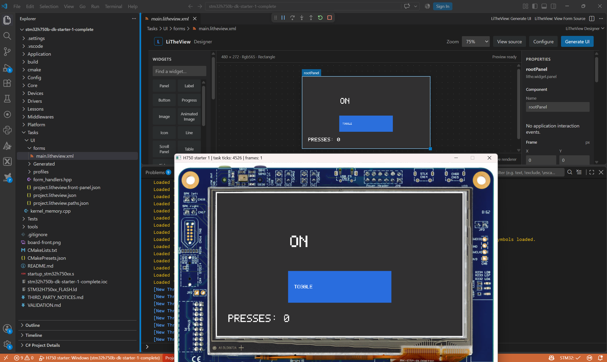

# LitheView

LitheView is a small, retained-mode C++ graphics and menu framework extracted from LiTheView's
`LCDViewGUI` design. It keeps the useful center of that implementation—bounded drawing, a view tree,
focus and pointer navigation, controller stacking, delegate actions, and XML-defined layouts—without
bringing along the product settings, filesystem, message bus, or target OS.

The maintained H750 starter applications build the same application logic and generated UI for
Windows and STM32, selecting their device implementations at build time. Internal rendering fixtures
separately check native formats, controls and constrained-memory Cortex-M33 rendering. The library
itself is standard C++23 and has no Win32, STM32, or FreeRTOS dependency.



*Design the form in VS Code, then build and debug the application in Windows.
The foreground window is the simulator using a board photograph; the Windows
and STM32 targets share the application logic and generated UI.*

## Your application is the project root

**LiTheView is a component of your application, not the superproject for your
product.** Open your own application or solution folder in VS Code. That project
owns the build presets, debug launchers, tasks, sensors, motors, drivers and other
middleware. LiTheView supplies the graphics library and form-design tools.

Choose a dependency location that fits your project:

| Application layout | LiTheView dependency | Your UI files |
| --- | --- | --- |
| STM32-style middleware | `Middlewares/Third_Party/LiTheView/` | `Tasks/UI/` |
| External dependencies | `externals/LiTheView/` | `src/ui/` |
| UI-local dependency | `UI/LiTheView/` | `UI/forms/`, `UI/Generated/`, and your handlers in `UI/` |

These are alternatives, not required folder names. Keep your forms, generated UI
and handwritten handlers outside the LiTheView dependency itself. The designer
records the library and output locations; your application CMake build integrates
them. See [project layouts and path configuration](docs/APPLICATION_INTEGRATION.md).

The examples in this repository are hosted here for distribution. When following
a starter, open that **example's folder** as the application workspace; its own
LiTheView submodule demonstrates the dependency relationship. You do not need to
put your product inside this repository or adopt its library-development layout.

## Getting started

**New machine? Start with [Install tools, build and run LiTheView](docs/BUILD_ENVIRONMENT.md).**
It includes official installation links, tool checks, a minimal Core build, a Windows rendering
window, VS Code designer setup and the additional H750 application requirements.

| Your goal | Start here |
| --- | --- |
| Build or integrate the portable library | [Build Core and run a consumer](docs/BUILD_ENVIRONMENT.md#3-build-core-and-run-a-consumer); no STM32, FreeRTOS or .NET required |
| Edit forms inside your existing application | [Prepare the VS Code designer](docs/BUILD_ENVIRONMENT.md#5-prepare-the-vs-code-designer), then [application integration](docs/APPLICATION_INTEGRATION.md) |
| Follow the Windows/STM32 lesson | [H750 starter](examples/stm32h750b-dk-starter-1/README.md), after its application prerequisites |

The starter pair includes the physical-button bonus, native RGB565 rendering and
portable application tool discovery. The guided starter remains blank; the completed
starter contains the button/counter result. Their Windows and STM32 validation is
recorded in the example READMEs and [public-release readiness](docs/PUBLIC_RELEASE_READINESS.md).
The remaining CubeMX template provenance limitation is documented in the
[STM32 inventory](licenses/stm32-examples.md); host checks and a successful cross-build
are not a license determination or physical-board acceptance.

The [product contract](docs/DISPLAY_MODEL_PLAN.md#product-contract) combines familiar,
extensible C++ controls with display-specific asset preparation and direct native
rendering. LiTheView's engineering standard is the C++ Core Guidelines with explicit
embedded constraints: bounded resources, typed interfaces, checked failures and
verifiable behavior, as defined by the [style guide](docs/style_guide.md) and
[memory contract](docs/SAFETY_AND_MEMORY.md). These are requirements for generated
code and application examples as well as the library; remaining gaps are tracked
in the plans and validation records.

Bringing up a new display or board? Start with the [step-by-step tutorial](docs/NEW_HARDWARE_TUTORIAL.md)
and [display/input worksheet](docs/DISPLAY_BRINGUP_WORKSHEET.md). Collect the display and touch/knob/button
details, create a project in the [designer](tools/designer/README.md), and choose **Generate UI**. Build and debug the application with its Windows
CMake preset and normal F5 launcher. The tutorial also shows the equivalent files you would write by hand, with a
[portable C++ starter](tests/rendering/display-bringup/README.md). Connect hardware drivers and measure the
target after the host application works. Surface compatibility can be established before an MCU is
selected.

Adding the UI to an existing firmware tree? The [application integration guide](docs/APPLICATION_INTEGRATION.md)
shows arbitrary submodule placement, designer output/build paths, parent CMake integration, and typed
handlers connected to application-owned display, touch, button, and other device classes.

Start with an already building application and no UI in the
[H750 blank starter](examples/stm32h750b-dk-starter-1/README.md): initialize the middleware
submodule, run **LiTheView: Add LiTheView UI**, enter a **Custom display**, then add
the fill and border to its blank canvas. Save, generate, build the Windows application
and press F5; then build and debug the STM32 target. The
[completed starter](examples/stm32h750b-dk-starter-1-complete/README.md) contains the
expected result with its custom display definition and generated form.

The [VS Code designer extension](tools/vscode/README.md) brings project creation and form editing into that
application workspace. CMake and the application IDE own builds and debugging. The
[shared application plan](docs/SHARED_APPLICATION_PLAN.md) describes the next complete-system
example: identical product logic and UI on host and MCU, with platform implementations selected
by the build.

## What is included

- Typed RGB565, RGB888, XRGB8888, and ARGB8888 surfaces with clipped painting, dirty-region
  presentation, alpha blending, lines, rectangles, and text.
- Native two-bit red rendering into packed 2 by 2 blocks, plus RRRR2222 red-cell and RYRY2222
  red/yellow-cell surfaces, with checked sizing and byte-exact full-frame/tiled conformance fixtures.
- Opaque RGB565/RGB888/XRGB8888 assets plus ARGB8888, 4-bit indexed, one-bit-alpha, and
  anti-aliased-alpha assets, with allocation-free integer bitmap scaling.
- Caller-owned `Display`, `Font`, and `ResourceProvider` interfaces.
- Compile-time-selectable compact 5 by 7 and generated ROM font backends, with regular/bold faces,
  bounded UTF-8 repertoires, anti-aliased coverage, measurement, wrapping, ellipsis, multiline layout,
  underline, line spacing, and per-run color.
- Fixed-capacity retained view trees with labels, text/icon and momentary/toggle buttons,
  checkboxes, radio buttons, caller-buffer text fields, progress, images/icons, lines, scrolling,
  scrolling table containers, delimiter-backed pickers and drop-downs, and two-sided softkeys.
- Typed control/form handlers for button clicks, toggles, checkbox/radio selections, picker values,
  drop-down selection/commit/cancel and bounded text editing. Generated hooks preserve application
  code; selectable table data/selection behavior remains planned.
- A lightweight MVC layer: focus navigation, captured press/move/release/cancel touch, draggable
  scrollbar thumbs, delegate actions, automatic scroll reveal, and a bounded controller stack.
- Configurable rectangular or circular logical viewports, implemented with integer clipping and no
  allocated shape mask.
- Timestamped, allocation-free tap, long-press, drag, and four-way swipe recognition with
  caller-selected thresholds and caller-owned time.
- Fixed-capacity scenes and overlays with left/right/up/down/drop-away transitions rendered through
  translated clips or the existing tile workspace rather than duplicate framebuffers.
- A no-I/O, no-allocation XML parser and caller-buffer writer for the original
  `className="LCD..."` object dialect.
- Original-style image sequences using `animationImageN`, `animationInterval`, and `repeatIndex`,
  advanced by an application-owned clock and clipped to their invalidated update rectangles.
- Caller-owned full framebuffers or exact format-preserving tile/strip rendering through a
  synchronous `TileSink`.
- `StaticLayout<N>` for either parsed XML or build-time `ViewSpec` arrays, with an optional
  `WidgetSet` so a product links only the widget kinds its forms use.
- Internal Windows rendering fixtures with a four-screen widget gallery, frame animation and input
  controls. These maintain library regression coverage; the H750 starters teach application integration.

There is deliberately no settings persistence or filesystem API. The demo model is ordinary static
storage. XML is compiled into the executable as a `constexpr std::string_view`, then parsed from a
caller-provided memory view. A product may obtain those bytes from ROM, a generated header, flash, a
network, or a filesystem owned by the application; the graphics package does not know which.

Tool versions, platform requirements, configurable tool locations and dependency ownership are
documented in [the build environment guide](docs/BUILD_ENVIRONMENT.md).

The checked Windows designer toolchain is [WinLibs GCC 14.2.0 / MinGW-w64 12.0.0](https://github.com/brechtsanders/winlibs_mingw/releases/tag/14.2.0posix-19.1.1-12.0.0-ucrt-r2).
Its upstream projects are [GCC](https://github.com/gcc-mirror/gcc/tree/releases/gcc-14.2.0),
[MinGW-w64](https://github.com/mingw-w64/mingw-w64/tree/v12.0.0), and the
[WinLibs build recipes](https://github.com/brechtsanders/winlibs_recipes).
LiTheView does not maintain or redistribute their source trees. The Windows designer VSIX includes
three compiler runtime DLLs with their license notices and version/hash record; see
[third-party notices](THIRD_PARTY_NOTICES.md#windows-designer-native-runtime).

## Build and run the Windows rendering fixtures

Requirements: CMake 3.25 or newer and a C++23 compiler. The checked Windows configurations use MinGW
Makefiles. Build either color-depth variant or both:

```powershell
cmake --preset windows-mingw-release
cmake --build --preset windows-mingw-release --parallel 2
ctest --preset windows-mingw-release
.\build\windows-mingw-release\tests\rendering\win32\litheview_win32.exe
.\build\windows-mingw-release\tests\rendering\win32\litheview_win32_round.exe

cmake --preset windows-mingw-rgb565-release
cmake --build --preset windows-mingw-rgb565-release --parallel 2
ctest --preset windows-mingw-rgb565-release
.\build\windows-mingw-rgb565-release\tests\rendering\win32\litheview_win32_rgb565.exe
.\build\windows-mingw-rgb565-release\tests\rendering\win32\litheview_win32_round_rgb565.exe
```

The first executable renders directly into XRGB8888 storage, matching the H750 RGB888-output variant.
The second renders into RGB565 and expands that completed framebuffer only at the Windows presentation
boundary, so the window shows the same color quantization as the original H750 variant.

Packed native formats are covered by synthetic tests under `tests/rendering`; retired display-specific
applications are not needed for setup. See [the animation asset guide](docs/ANIMATION_ASSETS.md)
for resource packing and lifetime details.

The demos' `AUTO` selection pairs the compact 5 by 7 font with RGB565 and the generated regular and
bold faces with the higher-color RGB888-output/XRGB8888-framebuffer variant. Configure a separate
build with `-DLITHEVIEW_DEMO_FONT_BACKEND=COMPACT5X7` or `GENERATED_SANS` to override that pairing at
compile time. Both font backends remain compatible with every framebuffer format. See
[the font and text pipeline](docs/FONTS.md) for the complete commands, ROM manifests, and API contract.
The parallel `LITHEVIEW_DEMO_ANIMATION_FORMAT` option accepts `AUTO`, `ALPHA1`, or `INDEXED4`.

Use Up/Down and Enter (or press/drag/release with the mouse) to navigate. Left/Right operates pickers and
softkeys; Escape goes back, and typed characters/Backspace edit a focused text field. The four-screen demo shows scrolling focus reveal, XML
construction, controller push/pop, caller-owned brightness/volume/profile values, a progress bar,
compiled icons, regular/bold fonts, an original-dialect frame animation, checkboxes, radio choices, a
bounded editable field, softkeys, and live light/dark styling. `WIDGET GALLERY` is initially focused;
press Enter once to see the animation and controls.

On Linux or another host, build the portable library and tests with the generator of your choice;
the Win32 adapter is only added when `WIN32` is true:

```sh
cmake -S . -B build/host -DLITHEVIEW_BUILD_WIN32=OFF
cmake --build build/host
ctest --test-dir build/host --output-on-failure
```

## Use as a CMake package

In a source tree:

```cmake
add_subdirectory(path/to/LitheView)
target_link_libraries(my_application PRIVATE LitheView::Core)
```

Or install and consume it with `find_package`:

```powershell
cmake --install .\build\windows-mingw-release --prefix .\build\installed
```

```cmake
find_package(LitheView CONFIG REQUIRED)
target_link_libraries(my_application PRIVATE LitheView::Core)
```

The public C++ API uses the `lithe` namespace and `<lithe/...>` headers. The installed CMake package is
`LitheView`. Core contains font rendering machinery but no bundled font tables. Code using the
compact default font links `LitheView::CompactFont`; code selecting bundled Sans links
`LitheView::GeneratedFonts`. Enable `LITHEVIEW_BUILD_GENERATED_FONTS=ON` before configuring the
library when that package is needed. Both optional targets bring in Core transitively.
Applications supplying their own fonts can disable both bundled-resource options and link Core alone.
See [optional fonts](resources/fonts/README.md) for configuration and migration details.

Examples own their scene code and graphics. The public package does not export `LitheView::Demo`
or install demo/animation headers. See the [example guide](examples/README.md) and
[library boundary cleanup](docs/LIBRARY_BOUNDARY_CLEANUP.md).

Select `LITHEVIEW_DESTINATION_FORMAT` when building the library: `RGB565`, `RGB888`, `XRGB8888`,
`ARGB8888`, `R2_PACKED2X2`, `RRRR2222`, or `RYRY2222`. `ALL` is the compatibility/conformance default. The generated
`lithe/render_config.hpp` is installed with its matching archive; `supportsDestination()` reports that
build's capabilities. Use separate build/install directories for different products.

An application can start from a `Viewport` with no framebuffer or MCU selected. Full-frame output
borrows a `Display` exposing a writable `Surface`; tiled output borrows a bounded workspace and a
synchronous `TileSink`. Windows rendering fixtures separately exercise RGB565 and XRGB8888 storage;
each application selects its own fixed native format and display driver. Compile-time `PixelSurface<Format>` types
establish storage contracts before the portable display boundary. See `docs/PIXEL_FORMATS.md` for
format, checked storage layout, alpha, tiling, and optional accelerated-transfer contracts.

Borrowed contiguous storage is represented by `std::span`: surfaces carry bounded pixel storage,
bitmap resources carry `std::span<const std::byte>`, XML APIs accept bounded spec/output spans, and
damage/tile callbacks receive spans rather than pointer-plus-length pairs. Text borrowed from XML and
resources remains `std::string_view`. Raw pointers are reserved for genuinely nullable lookups,
intrusive tree links, and documented platform ABI boundaries.

## Embedded examples

Start with the [H750 starter](examples/stm32h750b-dk-starter-1/README.md) and its
[completed lesson](examples/stm32h750b-dk-starter-1-complete/README.md). Both use the same
application interfaces in Windows and STM32 builds. The application owns CMSIS, STM32 drivers,
FreeRTOS, display transport and physical input; LiTheView is a dependency under its middleware tree.
Open the starter folder in VS Code and use its existing Win32 or STM32 CMake preset and F5 launcher.
Adding generated UI does not introduce another build configuration.

The root [test guide](tests/README.md) explains unit, rendering, integration and package tests.
Root regression launchers inspect library fixtures; they are not application templates.

The initial showcase applications are retired. Useful rendering and native-format checks live
under [tests/rendering](tests/rendering/README.md); they are internal regression fixtures.
The old H750 standalone runner, product-specific overlay, root vendor submodules and corresponding board
launchers were removed. Future display and feature teaching will use additional starter lessons.

The current H750 applications provide their own ST-LINK debug launchers. Each builds the selected
application before connecting. Obtain active-session shared-board permission before hardware access;
the workflow is documented in the selected application's README.

## Configuration and ownership

The fixed bounds are typed C++ constants in `include/lithe/config.hpp`:

- `lithe::config::kMaxChildren` (default 16)
- `lithe::config::kMaxDamageRegions` (default 8)
- `lithe::config::kMaxControllerDepth` (default 8)
- `lithe::config::kMaxFocusableViews` (default 64)

`StaticLayout<N>` supplies layout capacity at the call site. No component allocates from the heap.
`StaticLayout<N, lithe::WidgetSet<...>>` builds only the listed widget kinds, so the linker drops the
others; designer-generated forms provide theirs as `Form::Layout`.
Widget text and XML-derived names are non-owning `std::string_view`s; backing storage must remain valid.
Application-supplied bitmap/font tables likewise remain application-owned. The optional checked
generated font target owns its immutable tables for the lifetime of the program.

For the XML dialect and lifetime contract, see [docs/XML_LAYOUT.md](docs/XML_LAYOUT.md). The
[font and text pipeline](docs/FONTS.md),
[theme colors and widget states](docs/THEMES_AND_WIDGET_STATES.md),
[button variants](docs/BUTTONS.md),
[tab bar and tab view](docs/TABS.md),
[wheel picker](docs/WHEEL_PICKER.md),
[designer architecture](docs/DESIGNER.md),
[item 5 implementation plan](docs/ITEM_5_IMPLEMENTATION_PLAN.md),
[touch boundary](docs/TOUCH_INTEGRATION.md),
[scene, gesture, transition, and shaped-viewport contract](docs/SCENES_GESTURES_AND_VIEWPORTS.md), and
[safety/memory/power model](docs/SAFETY_AND_MEMORY.md) describe the modernized extension points. The
[LitheView style guide](docs/style_guide.md) defines the C++23, naming, macro, safety, and enforcement
rules for new and modernized code. The [cast audit](docs/CAST_AUDIT.md) and
[Core Guidelines safety audit](docs/CORE_GUIDELINES_AUDIT.md) record the enforced boundaries and
risk-ranked modernization results. For the old-to-new boundary and intentionally excluded product code,
see [docs/EXTRACTION.md](docs/EXTRACTION.md). The ordered next-development work is recorded in the
[modernization plan](docs/MODERNIZATION_PLAN.md). A fresh agent or checkout should begin with the
[agent handoff](docs/AGENT_HANDOFF.md). The task-1 host, cross-build, golden, static-analysis, and
resource-budget gates are defined in [the conformance guide](docs/CONFORMANCE.md).

## Current limitations

This is a reusable core and capability demo, not a source-compatible replacement for every historical
LiTheView product widget. It does not include localization string substitution, complex-script shaping,
bidirectional layout, display rotation, multi-touch gesture composition, a concrete DMA/DMA2D adapter, or
dose/battery/tagging/time product views. The current designer supports form editing and component
generation; application behavior and hardware integration remain developer-owned. Hardware
acceleration, buses, settings, persistence, localization, and product widgets remain independent
adapters or build-time tools.

Copyright (c) 2012-2026 Paul R. Decker. LiTheView is licensed under
[GNU GPL version 3 only](LICENSE) (`GPL-3.0-only`), with attribution and scope in [NOTICE.md](NOTICE.md).
Third-party resources and runtime binaries retain their own terms: see
[third-party notices](THIRD_PARTY_NOTICES.md) and [license provenance](licenses/README.md).
