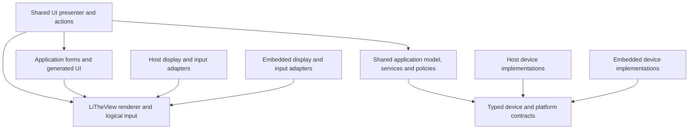

# One application, host and embedded platform builds

Status (2026-10-16): the [H750 starter](../examples/stm32h750b-dk-starter-1/README.md)
and [completed lesson](../examples/stm32h750b-dk-starter-1-complete/README.md) are the maintained
application examples. Windows and H750 compile shared application code against platform-owned
device interfaces. The designer edits forms and generates components and typed handler declarations;
CMake builds the application and VS Code launches it. The application owns RTOS configuration,
drivers and memory policy. The starters use static application/kernel storage; the broader selectable
memory policies below remain planned. See each starter's validation record for its evidence limits.

## Evidence from the LTE reference

Read-only architecture review on 2026-09-27 of the owner-supplied private LTE archive.
That archive is background material, not a LiTheView build dependency.
The legacy source was not copied, modified, built, or executed. The useful pattern
is its ownership and build structure; its implementation idioms are not a template
for new C++23 code.

| Reference evidence, paths relative to LTE | Architectural observation |
| --- | --- |
| `Platform/Win32/Simulation.vcxproj` and `Platform/LPC1850/EP3/LTM.ewp` both compile `Tasks/Application/ApplicationTask.cpp`, `Tasks/Power/PowerTask.cpp`, and `Tasks/UserInput/UserInputTask.cpp`, with shared `Feature` and `Frameworks` sources | The host runs the product application; it does not reproduce product logic in a separate mock UI. |
| Win32 project include paths and source entries select Win32 drivers and Micrium Win32 ports; the IAR project selects LPC1850 drivers and ARM ports | Device and OS implementations are selected by the build. |
| `Platform/Win32/WinMain.cpp` initializes the OS, constructs `ExecutiveTask`, and starts the scheduler; `Platform/LPC1850/main.cpp` constructs the same executive | Platform startup differs while the application task structure is retained. |
| `HAL/ADC/CADC.h`, with implementations in each platform's `drivers/adc/CADC.cpp` | Shared diagnostics and communications call the same ADC API. The inspected host implementation supplies synthetic values. |
| `HAL/LCDController/LCDController.h`, `Frameworks/LCDViewGUI/LCDViewGraphics/LCDViewGraphics.cpp`, and the two platform LCD implementations | Shared graphics produces pixels; the host LCD implementation presents them through Win32. |
| `Platform/Win32/drivers/usb/cusb0.cpp`, under `SIMULATOR_TCP_MODE` | The host device backend uses TCP while retaining the upstream port/task interface. The inspected Win32 serial implementation also contains stubs; this review does not establish functional simulation of every device. |
| `Services/API/CTask/CTask.cpp`, `Services/API/Memory/TaskMemory.h`, and the uC/OS/uC-MPU task-switch port | Per-task heaps and protection processes, privileged cloning into the recipient's heap, and explicit recipient-heap destruction form a deliberate ownership boundary. The host preserves software ownership without establishing hardware MPU enforcement. |
| Shared `HAL/FS/FSDriver.cpp`, uC/FS sources/configuration, and platform `drivers/qspifi/qspifi.cpp` | The same filesystem, settings and database paths operate on physical flash or the host's `SimQSPIFI.bin` device image. Platform substitution occurs below filesystem middleware. |

The top-level `LTE.cbp` is a broad project inventory. The Visual Studio and IAR
manifests above provide the concrete evidence for the two builds. No historical
build success, behavioral parity, or timing result is inferred from this source review.
The owner also recalls NXP, STM32, EM32 and Win32 deployments. This review traced
the available LPC1850 and Win32 build manifests, not all historical ports.

## Modern ownership boundaries



Arrows show source/build dependencies. Each platform's composition root constructs
and connects the shared tasks and its selected implementations; each executable
links only its chosen platform.
It does not require a runtime host-versus-MCU switch. Each host/embedded pair also
uses the same fixed product display configuration: size, shape, native format,
logical input, resources, and UI capacities. A different format or panel is a
different configured product build. PC window conversion and magnification stay
inside the presentation adapter.

The application owns sensors, motor/output control, communications, persistence,
time, tasks, and power policy. LiTheView supplies rendering, view behavior, logical
input, and generated UI contracts. Examples can demonstrate device interfaces
without making them compulsory graphics-library APIs or imposing folder names.

| Shared between builds | Selected by platform build |
| --- | --- |
| Product model, state transitions, validation, control policy | Startup, linker script, toolchain and board initialization |
| UI presenter, action handlers, input interpretation | Window/mouse/keyboard delivery or physical display/touch/encoder drivers |
| Protocol parsing, commands and application services | TCP/host byte transport or UART/USB device transport |
| Selected filesystem, storage format, settings and database behavior | Physical storage adapter or a file-backed simulated device |
| Timing decisions, timeouts, idle/wake policy | Clock, timer, sleep/wake mechanism and OS/RTOS port |
| Generated forms, resource selection and native renderer | Presentation, framebuffer/workspace placement, DMA/cache/bus integration |

Keep platform headers and platform conditionals out of shared application sources.
A shared header can declare a device class or functions, with the build selecting
either `Platform/STM32/...cpp` or `Platform/Win32/...cpp` to implement that contract.
This direct implementation substitution needs no abstract factory or virtual call.
When platform-private representations differ, keep their concrete state at the
platform edge and substitute through a small typed contract. Do not force OS or
HAL handles into a common device header to preserve identical class spelling.
Compose typed dependencies at startup. A concrete reference or compile-time policy
works where the implementation is known; a small non-owning `noexcept` virtual
interface works where substitution is useful. A virtual call is not a runtime
choice of product configuration. The application explicitly owns dependency
lifetimes and any memory required by its model, views and devices.

Follow the embedded C++ philosophy: bounded owned storage, `std::span` for borrowed
buffers, explicit units, checked `[[nodiscard]]` results, and compile-time size and
configuration checks. Use C++23 facilities supported by both selected toolchains.
Do not replace typed calls with `void*` plus callback pairs or heap-allocating
general-purpose callbacks. A real Win32, RTOS, or vendor C callback may need one
documented cast in its boundary adapter; pass typed references inward immediately.

Host backends implement the same observable contract, including errors and progress.
A TCP stream backend must account for partial reads/writes, framing, disconnects,
and bounded buffering. A synthetic ADC should support scripted values, unavailable
or stale samples, and injected errors. Host scheduling need not reproduce interrupt
timing, but shared application code must retain its ownership and synchronization
rules. For this example, run the same RTOS kernel and application tasks using its
Windows port, as LTE does with uC/OS. Keep kernel/task/queue behavior in the shared
system; replace the CPU port, ticks and simulated device delivery. LiTheView itself
remains RTOS-independent.

Preserve shared middleware as well as application code. When the product uses a
filesystem, compile the same selected implementation and relevant configuration
on host and MCU, replacing its block/flash device underneath. A host image then
exercises filesystem and persistence behavior. Define device geometry, bounds,
completion/error semantics and restart behavior at that boundary. Model raw flash
erase/program constraints when the selected interface exposes them; do not confuse
an erase-and-write API with raw programming. Add reproducible image creation/reset
and failure injection when the persistence example is introduced. The application
owns the middleware choice; neither uC/FS nor another filesystem becomes a Core
dependency. Hardware timing, wear and power-loss behavior require separate evidence.

Also provide a deterministic headless runner for the same product model/services.
It supplies explicit time and events without starting the kernel or a window. The
production tasks wrap those same operations. This supplements the same-RTOS host
application; it does not replace its task bodies with a second simulated application.

Enforce these boundaries in separate build targets for the product model, UI presenter,
tasks and platform implementations, with one shared source list across toolchains.
Among shared product targets, only the task layer depends on the chosen common
RTOS API; platform startup, ports and RTOS memory adapters may also use it.
Model/UI targets cannot see platform include paths; Core cannot depend on the consuming application. Folder
organization documents these rules, while target dependencies and an isolated
consumer build check them.

## C++23 implementation standard

LTE's C++11 implementation is architectural evidence. New application and adapter
code follows the updated `02-embedded-cpp-philosophy.md` in the owner's modem-core
white paper. In particular:

- Initialize values, prefer `const` and references, and make object/buffer ownership
  explicit. Use RAII where it expresses the actual resource lifetime; do not copy
  legacy global singleton construction or owning raw pointers by habit.
- Carry units and identifiers in types. Use `std::array` for fixed storage and
  `std::span` for borrowed buffers; derive bounds and assert invariants at compile time.
- Return one checked value/error convention for new application/device contracts,
  using the article's `[[nodiscard]]` result discipline and C++23 `std::expected`
  where appropriate. Handle failure before accessing a value. Existing library
  result contracts remain explicit at their boundary rather than being swept into
  an unrelated API rewrite.
- Keep the shared embedded execution path free of exceptions and RTTI. Select the
  application's storage backend explicitly: static-only, C heap or RTOS allocation.
  Preserve the allocation-free portable rendering operations and make application
  allocation phases explicit. Account for platform OS resources separately.
- Use `constexpr`, scoped enums and constrained templates where they strengthen a
  contract. Choose straightforward direct implementations or typed interfaces based
  on the actual dependency, without requiring inheritance or template machinery
  for every device.
- Keep C callback context conversions in the small C/Win32/RTOS adapters. Preserve
  types through all first-party C++ layers; do not add `void*` or `std::function`
  as a general device dispatch mechanism.
- Enforce the repository's formatting, warnings-as-errors and applicable static
  checks in small passes as files change. Assess memory, stack and timing costs
  alongside readability; using a newer language feature is not itself an improvement.

## Build-time memory policy

The product chooses one storage policy when it is built. Static-only remains the
default; dynamic allocation is an explicit supported option rather than a violation
of the product architecture. This choice belongs in application build configuration,
independently of the form, display surface, selected MCU and physical memory placement.

| Policy | Storage source | Ownership and failure behavior |
| --- | --- | --- |
| `STATIC` | Caller-owned objects, arrays, task stacks/control blocks and fixed buffers | No heap fallback. Required capacity is checked before use; exhaustion is reported. Fixed pools backed by static storage may recycle slots without growing a heap. |
| `C_HEAP` | Standard C `malloc/free` through a small application memory adapter | Explicit fallible allocation, typed ownership, object construction/destruction, and matching release through the same adapter. |
| `RTOS` | The selected RTOS memory adapter; initially FreeRTOS `pvPortMalloc/vPortFree` | The same typed ownership contract, with the application choosing the kernel heap implementation and its bounds. No fallback to the C heap. |

These labels describe the planned policy values. Add their actual preset/CMake
options with the storage owner and examples; do not expose an option that does
nothing. Select the backend's implementation sources at build time, as for other
device adapters. The Core target must not acquire a FreeRTOS or global-allocator
dependency. A dedicated optional ownership/adapter target can provide reusable
helpers while leaving caller-supplied storage APIs intact.

Three decisions must remain separate:

1. **Where storage comes from:** static storage, the C heap, or an RTOS allocator.
2. **When allocation is permitted:** startup-only or explicit runtime allocation.
3. **Which protection domain owns it:** application-wide storage, task-private
   storage, or a deliberately shared region, with defined access and release rules.

The third decision matters when the application uses MPU isolation; it does not
require every example to introduce protected tasks. LTE shows why a private heap
and a trusted message-copy boundary can be sound. Preserve that option without
making it a requirement of LiTheView or treating an allocator choice as permission
to access another task's storage.

For the deterministic tutorial, dynamic backends may prepare their objects and
buffers during initialization, then enter a checked allocation-closed running
phase. A product can explicitly enable runtime creation/destruction where it needs
it, and owns its failure, synchronization and timing policies. Release of an existing
owned allocation remains permitted during teardown. There is no implicit allocation
or free within parsing, layout, input dispatch, animation advancement or rendering.

The current library makes this possible without a renderer rewrite: `Surface` and
`TiledRenderer` borrow spans, and the generated `Product<Hooks>` borrows a typed
application handler. An owner may allocate a whole fixed-capacity product/layout or
workspace dynamically, then lend it to those APIs. Dynamic allocation does not by
itself make `StaticLayout<N>` grow, change its capacity, or invalidate retained
pointers. A future dynamically sized layout would be a separate explicit contract.

### Typed ownership and allocator boundaries

- Shared C++ uses typed owners, references and spans. C and RTOS allocation APIs
  return untyped storage; their conversions belong in the narrow memory adapter,
  under the same documented external-boundary rule as HAL and Win32 callbacks.
- Allocation results are `[[nodiscard]]` values carrying useful errors, including
  exhaustion, unsupported alignment, size overflow and allocation during a closed
  phase. A failed operation publishes no partially constructed object.
- Check object/buffer size arithmetic and alignment before construction. The adapter
  must satisfy the requested alignment or reject it explicitly; `malloc`'s ordinary
  alignment or `portBYTE_ALIGNMENT` is not proof of DMA/cache-line alignment or a
  required physical RAM region.
- Typed ownership pairs construction with destruction and release to the allocator
  that supplied the block, in a context permitted to access its protection domain.
  A typed owner or matching deleter alone does not grant cross-domain access.
  Borrowers, asynchronous transfers and tasks must retire
  before their storage is released. Keep the allocator alive until all owners retire.
  Transfer ownership without relocating a live layout/product whose members retain
  references to other members. Define zero-sized buffer behavior explicitly.
- Do not pass allocations between `free`, `delete` and `vPortFree`, globally replace
  `new/delete`, silently fall back to another heap, or use `realloc` to move live C++
  objects. Containers and ownership helpers must use the selected policy explicitly.
- Allocator selection supplies storage, not automatic thread safety or ISR safety.
  The adapter documents allowed callers and synchronization. Runtime heap operations
  stay out of ISRs and timing-critical rendering/input paths.
- A protected task receives a copy in its own domain, or uses an explicitly shared
  region with documented permissions. Do not transfer a pointer into a foreign
  private heap. Keep the privileged copy bounded and internal to the RTOS adapter;
  define cleanup if allocation succeeds but enqueue fails. Payloads must be
  self-contained or carry an explicit permitted ownership/lifetime contract.

Host scenarios can check domain ownership, capacity and transfer rules. Actual MPU
enforcement and access permissions require target tests; Windows execution alone
does not validate protection. This is an optional application isolation layer, not
an implemented feature or new dependency of Core.

### RTOS allocation and host parity

Application storage and RTOS kernel-object allocation are related settings, not the
same setting. FreeRTOS can use statically supplied task/queue storage while application
buffers use the C heap. If application storage uses the FreeRTOS allocator, the
application must supply a compatible heap implementation/configuration even when
its tasks are created statically. An entirely static embedded profile enables
static kernel-object creation and disables dynamic kernel allocation.

The checked FreeRTOS CMake integration adds a heap source by default. A static-only
consumer must deliberately omit it, as the existing H750 example does with an
explicit kernel source list; setting a configuration macro alone is insufficient.

The first FreeRTOS dynamic example should use a reclaiming allocator, such as the
selected kernel's `heap_4.c`, for the full allocate/release owner contract. `heap_1.c`
does not reclaim allocations and must not be advertised as supporting that contract;
an initialization-only arena would need a distinct capability/lifetime contract.
`heap_3.c` delegates to the C allocator, and `heap_5.c` needs its memory regions
initialized before use. The application selects exactly one compatible implementation.
See FreeRTOS's [static/dynamic allocation documentation](https://www.freertos.org/Documentation/02-Kernel/02-Kernel-features/09-Memory-management/03-Static-vs-Dynamic-memory-allocation)
and [application memory guidance](https://docs.aws.amazon.com/freertos/latest/userguide/application-memory-management.html).

The host simulator should run the same selected policy as its embedded counterpart.
For `RTOS`, use the same kernel heap implementation through the Windows port, with
an explicit region/budget suitable for each platform. A host-only C-heap comparison
is a separate preset and must not be presented as validation of the embedded RTOS
allocator. A `STATIC` host application still uses OS resources for windows and the
RTOS host port; the static claim applies to the shared application/Core and its
configured kernel-object ownership, not every allocation inside Windows.

### Implementation and validation gates

- Prove the static owner first, then C-heap and FreeRTOS owners behind the same
  typed interface. Exercise identical application behavior in all three builds.
- Check that static paths do not reference application heap allocation entry points;
  confirm the static kernel configuration and separately account for platform support.
- Test exhaustion and partial initialization rollback, alignment and overflow,
  construction/destruction, matching allocator release, and the running-phase gate.
- Exercise repeated dynamic create/destroy and deterministic allocation-failure
  injection. Verify no unexpected allocation during steady-state render/input/time
  processing and no stale span or retained pointer after an owner's retirement.
- Record static RAM/stack, configured heap reservation, allocator overhead and
  peak live usage separately. Do not double-count a heap array already in static
  RAM. Keep display-surface validity separate from target memory feasibility.
- Include static, C-heap and RTOS example presets, with matching simulator/embedded
  tasks where supported. Document exactly which policies were built, executed and
  measured; a stub allocator test does not establish an actual FreeRTOS heap run.

## Proposed consumer layout and startup

The owner has authorized rearranging first-party source files to express these
boundaries. Use a clean application layout rather than preserving the legacy tree
literally. This is an example layout, not a path convention imposed by the designer:

```text
ApplicationRoot/
  Drivers/
    CMSIS/                         STM32 default location
    STM32L4xx_HAL_Driver/           STM32 default location for this board
  Core/Inc/                        Cube-generated configuration
  Core/Src/                        Cube-generated support files
  Middlewares/Third_Party/
    FreeRTOS/                      one selected kernel revision
    LiTheView/                     pinned graphics/tooling submodule
  Application/
    system.hpp, system.cpp         shared system construction/task startup
    model.hpp, model.cpp           shared product state and policy
  Tasks/
    sensor_task.cpp                shared task bodies
    UI/
      ui_task.cpp, presenter.cpp   shared task and typed form integration
      project.litheview.json
      project.litheview.paths.json
      forms/, profiles/, Generated/
  Devices/
    display.hpp, input.hpp         shared device contracts
    sensor.hpp, output.hpp
  Platform/
    STM32/
      main.cpp                     embedded entry and platform preparation
      display.cpp, input.cpp       STM32 implementations of shared contracts
      sensor.cpp, output.cpp
      rtos/                        target RTOS port configuration
    Win32/
      main.cpp                     Windows entry and platform preparation
      display.cpp, input.cpp       Windows implementations of shared contracts
      sensor.cpp, output.cpp
      rtos/                        Windows RTOS port configuration
  Config/                          shared product and RTOS policy
                                   selected memory source and allocation phase
  cmake/, CMakePresets.json         application-owned platform selection
  .vscode/tasks.json, launch.json   application-owned build/run/debug
```

Both entry points prepare their platform, construct the platform-owned devices,
call the same system startup function, and start the same kernel/application task
set. The Windows message pump and simulated I/O are host device infrastructure,
with explicit bounded event/frame handoff to the application task owner. They do
not replace the RTOS tasks with a second application loop.

Keep the vendor HAL/CMSIS and Cube support files in their expected locations.
Select one executable entry point explicitly in CMake. If retaining Cube's generated
`Core/Src/main.c` as the embedded entry, use its user section to call a narrow C/C++
startup bridge and omit the illustrative `Platform/STM32/main.cpp`; do not compile
two mains. Preserve generation ownership when moving existing first-party board code.

The checked LiTheView FreeRTOS checkout contains `portable/MSVC-MingW/port.c` and
`portmacro.h`; this establishes available source, not a validated host RTOS build.
Its source explicitly says simulated ticks do not provide real-time performance.
The current display-test CMake target compiles `Board/main.cpp`, whose loop is
bare-metal; the Cube `Core/Src/main.c` RTOS skeleton is not that target's entry.
An early feasibility gate is a small host/MCU kernel-and-shared-task build using one
pinned kernel revision, run in parallel with the deterministic product-model work.
Integrate the proven UI work after both gates pass. Check host-port threading/interrupt
rules and middleware version compatibility
before attaching window, TCP or device callbacks. Do not infer that copying a
Windows port into an unrelated Cube kernel version is sufficient.

## Current fit and remaining gap

The portable generated `Product<Hooks>` already borrows a typed handler and owns no
OS, device, task, or physical framebuffer. The current board integration and generated
Win32 starter use the same generated UI and handwritten `application.hpp` hook.
The VS Code extension invokes existing application tasks without synthesizing an
alternative build or replacing debugger configuration.

The original tutorial hook demonstrates button actions and status text. Its Win32
starter has its own input/timer loop, and the board integration has its own scheduling
and idle/wake loop. That demonstrates UI portability, but does not yet demonstrate
shared sensor, control, communication, and power-policy behavior. The generic designer
preview remains a layout tool. A generated standalone UI simulator remains useful
for isolated UI bring-up; the full product simulator is an application-owned target.

The new H750 example now supplies that application-owned target for a bounded sensor/LED/control
scenario. It exercises the same FreeRTOS task bodies on Windows and MCU, including simulated sensor
failure/recovery, static queues and generated controls. Communication, persistence, dynamic memory
policies and idle/wake behavior below remain subsequent increments; they are not inferred from the
new example's successful host tests and H750 runtime readback.

## Next implementation increment

1. Implement one bounded product scenario: sensor result and user action become
   model changes, output commands and UI state, including idle/wake and failures.
   Give the model explicit time and a deterministic headless scenario runner.
   In parallel, prove a tiny shared RTOS task runs on Windows and cross-compiles
   for the selected MCU using one pinned kernel revision.
2. Establish separate model/presenter/task/platform targets, one shared source list
   and the two platform entry points. Compose the static application and run the
   same production task bodies around the model on host and MCU. Keep the library
   and generated UI locations configurable. Define ownership, pending completion,
   cancellation, permitted callers and full-queue behavior at device boundaries.
3. Connect the existing generated forms and native display configuration. Add host
   display/input, scripted sensor values/failures, visible output and controlled
   event delivery. Add embedded adapters using documented available board signals.
   Keep view text storage alive for the renderer. Choose physical ADC/device wiring
   from board evidence; distinguish a test fake from a real sensor run.
4. Define application-owned `build-sim`, `run-sim`, and `build-embedded` tasks/presets,
   and separate host/embedded debug configurations. The designer selects those existing
   tasks. Hardware download remains an explicit application debug/flash action.
   Prove designer edit through simulation/scenarios and firmware build before adding
   another infrastructure dimension.
5. Add C-heap and FreeRTOS storage owners alongside the static default, with the
   failure, alignment, allocator provenance and phase tests specified above. Validate
   the real selected backend, including the RTOS heap in the Windows system build.
   Broaden communication/device scenarios after the first complete path is proven.
   A persistence extension should retain the selected filesystem on both platforms,
   add the file-backed device image, and exercise restart and storage-error scenarios.
6. Extend the tutorial from form editing through handwritten backend integration,
   simulator scenarios and embedded deployment. Show the exact generated files and
   the equivalent manual creation path. The same instructions must work with LiTheView
   in an arbitrary submodule directory.

Acceptance requires more than two successful links:

- Verify that both builds compile the same application/model/presenter source files
  and product definitions. Only platform sources and target build requirements differ.
- Replay the same input, sensor and elapsed-time scenario through the shared application;
  compare state transitions, output commands and UI state. Include unavailable/stale
  sensor data, activation, delayed ticks, and idle/wake behavior where implemented.
- Keep the native renderer and surface configuration in the host run. Validate shared
  behavior without requiring an MCU selection; apply target flash/RAM/workspace/transfer
  checks separately when configuring firmware.
- Check generation preserves handwritten model, presenter and platform code. Designer
  edits must flow into both builds without copying application logic between folders.
- Retain distinct results for host execution, firmware cross-build and physical hardware
  checks. Simulation confidence covers shared behavior; physical display timings,
  electrical behavior, DMA/cache integration and real-time margins need target evidence.

The first useful milestone is one complete shared application path, not a universal
device simulator framework. Broaden its device examples once that path is proven.
