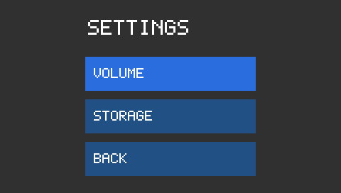
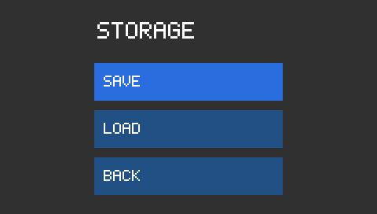
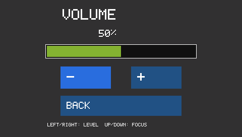
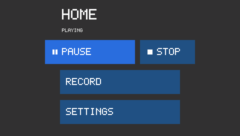
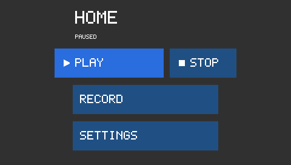
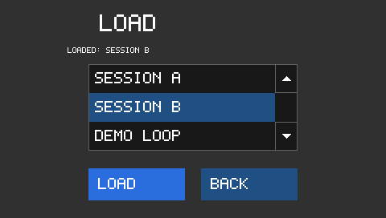
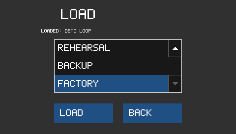

# Completed menu with selectable Load list: STM32H750B-DK

A finished menu demonstration built from designer forms and an **application-owned FSM**.
The same application and FreeRTOS task run on Windows and STM32H750B-DK with native
480 x 272 RGB565 rendering. For the step-by-step lesson, follow the
[round L4R9 tutorial](../stm32l4r9i-disco-menu-1/README.md); it starts with a blank application
and explains custom display definition, circular clipping, form creation and handlers.

```text
Home
  Play / Pause         (custom button and playback state)
  Stop                 (separate custom button)
  Record               (placeholder)
  Settings -> Settings
                Volume -> Volume (0-100%, +/- and Back)
                Storage -> Storage
                             Save (placeholder)
                             Load -> Load list (select entry, LOAD, Back)
                             Back -> Settings
                Back -> Home
```






## Build and run

Open **this application directory** in VS Code. LiTheView is a submodule under
`Middlewares/Third_Party/LiTheView`, alongside the application's FreeRTOS dependency;
it is not your application's superproject. STM32 HAL and CMSIS are also pinned submodules.
The directory can be a standalone application; it has no sibling-example build dependency.

Install the [application tools](../../docs/BUILD_ENVIRONMENT.md): PowerShell 7.2+, CMake
3.25+, Ninja, i686 MinGW for the 32-bit Windows FreeRTOS port, Arm GNU C++ 14+, VS Code
C/C++, CMake Tools and STM32 debug support. Then:

```powershell
./tools/init-platform.ps1
./tools/init-litheview.ps1
./tools/configure-tools.ps1
./tools/build.ps1 -Preset win32-debug -Action Test
```

Select **win32-debug**, build, choose **H750 menu: Windows**, and press **F5**. Click
SETTINGS, STORAGE, BACK, BACK. Arrow keys move focus; Enter/Space selects; Escape/Backspace
goes back one level. Back at Home is harmless. Play/Pause and Stop change the playback demonstration state.
Record and Save remain placeholders for real application behavior.

Select **stm32-debug**, build, choose **H750 menu: STM32H750 (ST-LINK)** and press **F5**.
Enter the intended probe serial when prompted, especially if another board is connected.
The touchscreen uses the same generated callbacks and navigation state machine.

## Edit the forms

Prepare and install the VS Code designer using:

```powershell
./Middlewares/Third_Party/LiTheView/tools/prepare-vscode-designer.ps1
```

Use a compatible .NET SDK (see the dependency's `tools/designer/global.json`); pass
`-Dotnet <path>` if needed. Install the emitted VSIX and reload VS Code. Preparation also
places the matching MinGW runtime DLLs alongside the native preview worker.

Open a form with **Reopen Editor With > LiTheView Designer**:

| Page | Form | Handwritten behavior |
| --- | --- | --- |
| Home | `Tasks/UI/forms/Home.litheview.xml` | `Tasks/UI/handlers/Home.hpp` |
| Settings | `Tasks/UI/forms/Settings.litheview.xml` | `Tasks/UI/handlers/Settings.hpp` |
| Storage | `Tasks/UI/forms/Storage.litheview.xml` | `Tasks/UI/handlers/Storage.hpp` |
| Volume | `Tasks/UI/forms/Volume.litheview.xml` | `Tasks/UI/handlers/Volume.hpp` |
| Load | `Tasks/UI/forms/Load.litheview.xml` | `Tasks/UI/handlers/Load.hpp` |

One designer project owns all five forms. **Configure** edits their shared display
and input; **Generate UI** exports the selected screen into `Generated/<Screen>`
and preserves its handwritten handler. After a shared configuration change,
regenerate every screen. Builds reject mismatched exported contracts. Runtime
navigation remains an application-owned FSM, separate from designer navigation.

The canvas is `480 x 272`, rectangle, native RGB565. Settings and Storage titles are at
`120,20,240,40`, text scale 3. Their buttons are `120,80,240,48`, `120,140,240,48`, and
`120,200,240,48`, text scale 2. Home adds a playback status label and separate Play/Pause
and Stop controls; its current geometry is in the Home form.
Save, Generate UI, then build and debug with the existing platform preset and launcher.
CMake owns builds; the designer edits forms and exports components.

## Adjust volume

Open **Settings > Volume**. The application value starts at **50%**, changes in **5% steps**,
and saturates at **0%** and **100%**. The percentage and shaded progress bar show the same
value. Back returns to Settings; reopening Volume retains the value during this run.
Restarting resets it to 50%; this demonstration has no persistent settings or audio driver.

- Touch/click **-** or **+** to decrease/increase.
- Windows **Left/Right** represent joystick directions and adjust only on Volume.
- **Up/Down** move focus between -, + and Back; **Enter/Space** activates it.
- **Escape/Backspace** or the Back button returns to Settings.

The H750 hardware uses touch; it has no L4R9-style directional joystick. The round-board
tutorial maps its physical joystick to the same logical keys.

`Application/volume.hpp` owns the bounded model without GUI or RTOS dependencies.
`Tasks/UI/handlers/Volume.hpp` uses generated `getVolumeProgress()` and `getLevelLabel()`
accessors. Buttons and horizontal keys call the same `adjust(VolumeChange)` method. The
label borrows immutable percentage strings with static lifetime. Its background matches
the panel so it repaints independently of the progress bar. Generate UI preserves the
handwritten handlers. All UI mutation belongs to the shared application task.

## Custom Play/Pause and Stop controls

Home starts **STOPPED**, showing a triangle with **PLAY** and a separate square with **STOP**.

| Current state | Play/Pause activation | Stop activation |
| --- | --- | --- |
| Stopped | Playing; show pause bars and PAUSE | Stay stopped |
| Playing | Paused; show triangle and PLAY | Stopped |
| Paused | Playing; show pause bars and PAUSE | Stopped |

The status label describes the current state; the button describes the next action.
State survives Settings/Storage/Back navigation during this run. Restarting returns to
stopped. This lesson controls a demonstration model, not an audio device.




- `Application/playback.hpp` owns the three-state model independently of the GUI and RTOS.
- `Controls/transport_button.hpp` defines application-owned `PlayPauseButton` and
  `StopButton` subclasses of `lithe::ButtonView`. They inherit focus, press, release,
  cancellation, disabled-state and keyboard behavior.
- `Tasks/UI/playback_controls.hpp` specializes the generated form with named
  `PlayButtonType` and `StopButtonType` overrides. Generated accessors return the custom
  types without casts; regeneration does not overwrite the specializations.
- `Tasks/UI/handlers/Home.hpp` owns the model. Its named handlers update the model,
  then the typed buttons and status label. All mutation happens in the application task.

Three fixed **16 x 16 alpha1 masks** are constructed at compile time: triangle, pause bars
and stop square. Their mask data totals **96 bytes**. ButtonView draws them using the
current foreground color directly into the native RGB565 surface; there is no RGB image
or runtime symbol scaling. Static mask and label storage outlive the forms.

The designer previews the base button layout and authored text. It does not execute
application-defined C++ subclasses. **Save, Generate UI, build win32-debug and F5** to see
the custom symbols and behavior. The images above are native runtime renders.

Try Play, Pause, Play, then Stop. Use arrow keys to focus Stop and Enter/Space to activate.
Press and drag outside a button before releasing: it must not activate. Navigate to
Settings/Storage and back while playing or paused; state must remain. Build stm32-debug
and use the existing STM32 launcher for the same touch behavior on hardware.

## Load from a selectable list

Choose **Settings > Storage > Load**. The page offers eight entries: SESSION A, SESSION B, DEMO LOOP, RECORDING 1,
RECORDING 2, REHEARSAL, BACKUP and FACTORY. Only three rows fit at a time.
One row is highlighted; this is a custom single-column list, not a set of radio buttons.

- Touch/click a row to select it. Selection alone does not load anything.
- With the list focused, **Up/Down** changes the highlighted row and clamps at the ends.
- **Enter/Space** on the list loads its highlighted entry; the separate **LOAD** button
  performs the same action. The label reports the last loaded entry.
- **Left/Right** moves focus between the list, LOAD and BACK.
- Back returns to Storage (depth 3); reopening Load (depth 4) retains the selected and
  loaded identities. Restarting resets them. Dragging off a row cancels its selection.





`Controls/selection_list.hpp` is an application-owned `ControlView` with a borrowed
immutable catalog and a typed `ListEvents` observer. `Tasks/UI/handlers/Load.hpp`
uses the generator's named `EntryListType` override to replace the designer's
`entryList` panel with this real control. Its callbacks update `Application/load_selection.hpp`.
The model distinguishes selection from activation and uses typed entry IDs. No filesystem,
audio service, erased context pointer or dynamic row allocation is involved.

The example catalog contains eight demo entries, not files read from storage. Use the
up/down arrow targets at the right of the list to move the selection and scroll it into
view with touch or a mouse. Keyboard Up/Down does the same. The control accepts 1-64
rows, clamps at each end, keeps the selected row visible, and does not
implement touch-drag scrolling, multiple columns, sorting or filesystem discovery. Those
are later requirements for a general list/table component. The library's current
`TableView` remains a scroll container; this lesson does not claim to implement a full
library table or add it to the designer's widget catalog.

The designer edits the named panel's position, dimensions and colors. Its rows are drawn
by application C++ in the simulator and on hardware, just as the playback symbols are.
Keep the list at `110,80,260,108` with text scale 2: three fixed 36-pixel rows.
Generate UI preserves the handwritten type override and callbacks.

## How it works

- `Application/navigation.hpp` defines the five pages and legal transitions without GUI or RTOS dependencies.
- `Application/menu.hpp` owns five persistent generated-form instances and the controller stack.
- Button handlers offer one typed request; scene changes happen after input dispatch returns.
- Push/pop succeeds before the FSM commits its new state. Repeated opens cannot grow the stack.
- Back restores a persistent parent form and its focus. No callback deletes its own form.
- `Application/app_main.cpp` runs the shared application task. Windows and STM32 select different device implementations.

The Windows input thread publishes bounded samples for the RTOS task. Rendered frames use
an ownership-transfer buffer rather than letting the window thread mutate controls.
The H750 adapter renders native RGB565 and updates damaged regions in the LTDC scanout,
retaining the earlier fix for full-screen refresh flicker. No RGB888 staging framebuffer is used.

Tests exercise all generated button handlers, 100 nested navigation cycles, logical Back,
focus restoration, bounded requests, volume bounds/persistence, native progress pixels and the Windows input-to-render path. Read the
[validation record](VALIDATION.md) for the distinction between host, MCU build and hardware
results. Vendor notices and compiler-runtime provenance are in
[THIRD_PARTY_NOTICES](THIRD_PARTY_NOTICES.md).

## Board photograph in the Windows simulator

The completed menu carries forward the H750 starter's `board-front.png` and
`Tasks/UI/project.litheview.front-panel.json`. The simulator draws its native
480 x 272 display over the LCD in that photograph. Mouse coordinates are mapped
back to native display coordinates; the image does not become a firmware asset.
Clicking the blue B1 button activates the focused control through the same
application debounce and input path as the physical board. Arrow keys move focus
(or adjust Volume and the Load list), and Escape goes Back.

To change the photograph or hit regions, open Home in the designer, choose
**Configure**, and edit its front view. Reconfigure/build the usual `win32-debug`
preset, then use the same Windows F5 launcher. CMake checks the photo hash and
copies it beside `starter.exe`. If you move that executable, move `board-front.png`
with it. The STM32 build does not include or decode this photograph.

## Switch screens in the designer

Open any form above in VS Code. The designer's **Screens** section lists all forms
whose project paths identify this application root. Click Home, Settings, Storage,
Volume or Load to open that screen in its own editor tab. **Refresh screens** picks
up a page you just added or renamed. Hover a screen name to see its relative path.
Unsaved changes and undo history stay in the original VS Code document. Generate UI
still applies to the active form; the application's FSM owns runtime navigation.

The forms live in separate Tasks subfolders to keep each generated component and its
handwritten handlers together. The Screens list groups them without moving them.
The blank round-display tutorial adds these forms as you complete its lessons.
If VS Code shows Restricted Mode, trust your application folder to run the preview;
screen discovery itself only reads project metadata and does not run a service.

## UI project ownership

All five XML forms are in `Tasks/UI/forms`, listed in one `project.litheview.json`.
The one `profiles` directory defines their shared display and logical input. The
paths sidecar uses `Tasks/UI/Generated/{form}`; generated files are grouped by Home,
Settings, Storage, Volume and Load. Handwritten classes are in `Tasks/UI/handlers`.
The menu's FSM owns these persistent forms; **there is one application/UI task**.

Use **Add screen** to create another form in this UI project. Design it, Generate UI,
create its event handlers, then add the desired transition and form ownership to
`Application/menu.hpp` and `Application/navigation.hpp`. Merely creating a screen
does not add it to the running menu or create a task. The CMake presets stay the same.

Generate UI operates on the selected screen. To regenerate all five at once, run
the designer CLI's `component export-project` with this shared manifest and the
absolute library checkout path. Configure applies to all screens; regenerate each
one before building after a display or input change.

## Known hardware limitation

A touch-controller I2C timeout was observed during the latest hardware check. This
example currently propagates a failed touch read to the UI task's fatal assertion;
resetting restored operation in that run but did not resolve the cause. Investigation
is deferred for this example. A product should diagnose the bus fault and validate
input recovery. See [the validation record](VALIDATION.md).
