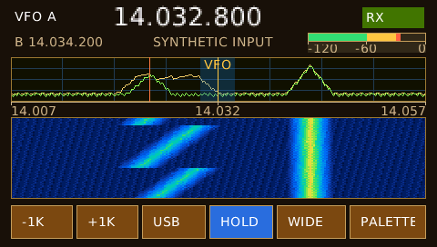

# H750 SDR display demonstration

This is a separate H750 application showing how to compose a
compact instrument screen from reusable LiTheView controls. The 480 × 272
RGB565 screen includes a tunable A frequency and fixed B reference, signal meter, live spectrum trace,
decaying peak trace, grid, markers and a highlighted range, frequency axis,
calibrated meter, 16-color scrolling waterfall, and six touch or keyboard
controls. Its samples are deterministic **synthetic data**. No RF receiver,
audio pipeline or DSP is implied by the display.



The [designer form](Tasks/UI/forms/Sdr.litheview.xml) owns the screen layout,
colors, labels, plot, overlay, axis, meter, waterfall and buttons. Generate UI produces
`Tasks/UI/Generated/Sdr/form.hpp`; the handwritten
[`sdr::Screen`](Application/sdr_screen.hpp) derives from its typed instance and
binds the live trace, waterfall storage and button handlers. Regenerate after
changing the XML; do not edit the generated header by hand.

This screen builds its form with the optional 14 px DejaVu Sans resource instead
of enlarging the compact 5 × 7 font. The main frequency uses a 2× text scale;
the smaller labels, axis, meter and buttons use the font at its native size.
CMake opts into `LitheView::GeneratedFonts` for both the Windows simulator and
the H750 firmware. The font tables are pre-rasterized ROM data, not runtime TTF
loading, and add about 9.2 KiB of regular-face coverage and records before
linker overhead. Their license and source are recorded in
[the font notice](../../THIRD_PARTY_NOTICES.md).
The current designer preview still uses its compact font, so the generated form
shows the same frames and text but not the final glyph appearance. Run the
Windows simulator to judge the finished typography.

The same `sdr::Screen` object
runs in the Windows FreeRTOS simulator and the STM32 firmware. Only the
`Platform/Win32` and `Platform/STM32` device adapters differ. Input arrives in
the single UI task; neither an ISR nor a host window callback writes the view
tree directly. The six controls tune by ±1 kHz, cycle USB/LSB/AM, hold/resume
the display, change the synthetic span and switch waterfall palettes. The
board's B1 button activates the focused control; touch works on the H750.

The spectrum uses `PlotView` with a live sample snapshot and a second,
application-owned peak snapshot. The amber peak line decays by one sample unit
per update; that policy is in `Screen::tick()`, not the plotting control, so the
same secondary trace can show a reference or another sensor in other projects.
The separate `AxisView` uses three caller-owned frequency labels. Tuning moves
their center; the span button changes their endpoints. The library draws ticks
and labels but has no SDR frequency model, so another application can reuse it
for time, temperature or any calibrated range.
`MarkerRangeView` draws a highlighted analysis region and two markers over the
trace. The moving marker follows synthetic data; the center marker stays at
the VFO position. `MeterView` maps synthetic amplitude onto an illustrative
-120..0 scale with green, amber and red zones. This is a display exercise,
not an RF power calibration. Both controls take bounded application-owned
values and leave measurement policy outside LiTheView.
The waterfall
uses `WaterfallView` with 64 rows × 228 columns of four-bit palette indices,
or **7,296 bytes** of application-owned history. The views allocate no heap
storage. The H750 still uses its normal two native RGB565 display buffers in
SDRAM. This example's palette and dimensions are application choices; the
library does not bake in SDR color schemes, radio terminology or STM32 drivers.

## Build and debug in this checkout

Open **this example directory** in VS Code. LiTheView remains a library of the
owning application, not the product's superproject. This development copy
shares the H750 vendor/FreeRTOS submodules already pinned by the sibling
`stm32h750b-dk-starter-1` and uses the current repository library source.
Those are default CMake paths, not absolute paths to this computer. If you
extract the example, put dependencies under your own `Drivers` and
`Middlewares/Third_Party` directories or pass `H750_PLATFORM_ROOT` and
`LITHEVIEW_ROOT` to CMake. Independent submodule pins for this new example
must be made after the telemetry views land in a library commit.

Open `Tasks/UI/forms/Sdr.litheview.xml` to edit the screen in the designer.
The palette includes **Plot**, **Axis**, **Marker and Range**, **Calibrated Meter**
and **Waterfall** under Data. Save the form and
choose **Generate UI** before rebuilding the simulator or firmware. The
preview uses sample data so you can judge placement; changing the form does
not alter the synthetic generator in `Screen::tick()`.

The form groups its header, spectrum and buttons in transparent Panels. LiTheView
allows at most 16 direct children under one parent; the original flat SDR form
filled all 16 root slots. Add controls to the appropriate panel or add another
panel when a section grows. Plot and Waterfall are already present as
`spectrumPlot` and `spectrumWaterfall`; palette clicks add *new* instances.

Initialize the sibling H750 dependency submodules if they are missing, without
resetting any existing local submodule checkout:

```powershell
./tools/init-platform.ps1
```

Select `win32-debug` in CMake Tools, build the `starter` target and choose
**H750 SDR: Windows** in Run and Debug. The F5 launcher builds the same
application before starting GDB. Select `stm32-debug` to cross-build the same
application for the H750. **H750 SDR: STM32H750 (ST-LINK)** is the hardware
launcher; choose the H750 probe explicitly if several boards are connected.
Building does not program the board.
When F5 asks for the **ST-LINK serial**, enter the H750 probe's serial number;
do not accept an empty value. With multiple probes attached, an empty serial
causes the GDB server to stop with `Multiple debuggers detected`. The number is
specific to your board, so this example does not store one in `launch.json`.
Keep `.settings/ide.store.json` beside this example's project files. The STM32
VS Code debugger reads its device and core fields when starting a hardware
session; a successful pre-launch build alone does not start the download.

For terminal verification:

```powershell
./tools/build.ps1 -Preset win32-debug -Action Test
./tools/build.ps1 -Preset stm32-debug
```

Use the mouse on the LCD controls. Left/right keyboard keys move focus and
Enter activates it. The synthetic source deliberately remains outside the
library: replace `Screen::tick()` with a completed measurement snapshot from
your own acquisition task, queue or DMA handoff, then publish it on the UI
task. Keep calibration, demodulation and radio state in the application.

The screenshot was rendered from `sdr_controls_test` with the generated form
used by both builds. The designer previews a bounded synthetic trace and
waterfall history so the placement is visible; the application supplies its own
data at runtime. Plot range, grid, cursor and waterfall palette are still set
by the handwritten presenter. [Validation](VALIDATION.md) records the exact
checks and their limits. The reusable controls and remaining designer work are
described in [telemetry views](../../docs/TELEMETRY_VIEWS.md).
