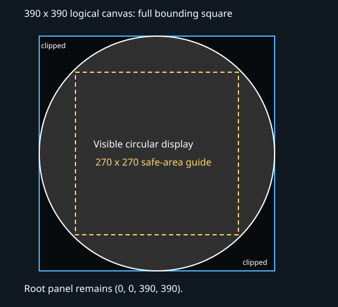
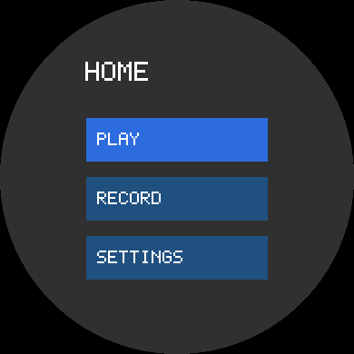
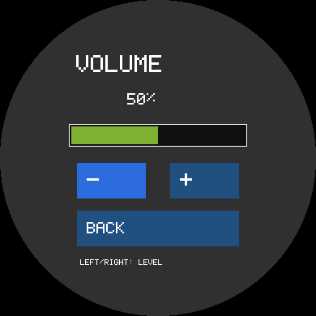
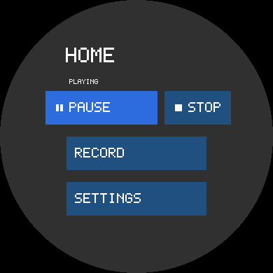
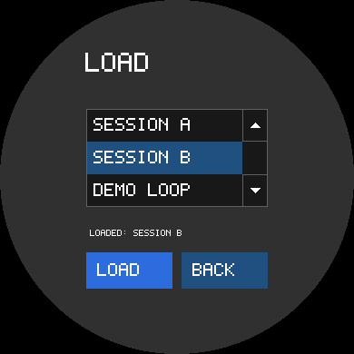
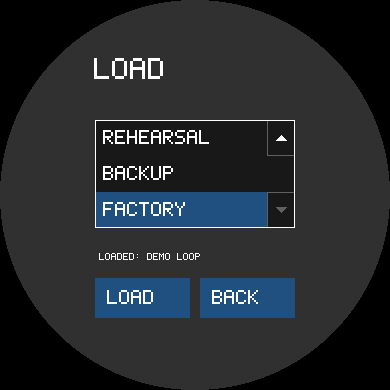

# Round-display menu tutorial: STM32L4R9I-DISCO

Start with a working application and one FreeRTOS task, define a **custom round display**,
then build a three-level menu in the VS Code designer. Run the same application on Windows
before downloading it to **MB1311 C-02 / MB1314 C-01**.

This example ships **without a UI project**. Its platform code and lesson support are ready;
you create the forms under `Tasks/`. The [H750 menu](../stm32h750b-dk-menu-1-complete/README.md) is
the completed reference, using the same menu behavior on a rectangular RGB565 display.
There is no separate completed L4R9 example.

## 1. Open your application and initialize dependencies

Open **this example directory** in VS Code, not the LiTheView repository root. The
application owns its RTOS, drivers, build and debug configurations. LiTheView is a
middleware dependency; your own project could put it under `externals/` or `UI/` instead.

```text
stm32l4r9i-disco-menu-1/       <- application / VS Code workspace
  Application/               <- shared task, FSM and form ownership
  Board/, Core/, Devices/    <- board startup and device interfaces
  Drivers/                   <- ST HAL, CMSIS and board support submodules
  Middlewares/Third_Party/
    FreeRTOS/, FreeRTOS-Kernel/
    LiTheView/               <- library + designer submodule
  Platform/Win32/, STM32/    <- implementations selected at build time
  Tasks/                     <- your forms and handwritten handlers go here
  Lessons/Handlers/          <- code explained in step 7; not active yet
  CMakeLists.txt, CMakePresets.json, .vscode/
```

Assume the STM32 startup, FreeRTOS task and both platform toolchains are already working.
For this checkout, initialize the pinned platform dependencies with `./tools/init-platform.ps1`.
The first LiTheView integration step is:

```powershell
./tools/init-litheview.ps1
```

In your own Git application, without an existing gitlink, the equivalent is:

```powershell
git submodule add https://github.com/kg7hf/LiTheView.git Middlewares/Third_Party/LiTheView
```

Do not run that `add` command again inside this example. Do not recursively initialize the
library's examples. The recorded library commit avoids nested example repositories; it is
a reproducible source dependency, not a product release or stable-API promise.

Install the tools listed in [BUILD_ENVIRONMENT](../../docs/BUILD_ENVIRONMENT.md): PowerShell
7.2+, CMake 3.25+, Ninja, an **i686 MinGW** compiler/debugger for the 32-bit FreeRTOS Windows
port, Arm GNU C++ 14+, and the VS Code C/C++, CMake Tools and STM32 debug extensions.
The designer additionally needs the .NET SDK selected by its `global.json` and a native
host compiler. Run:

```powershell
./tools/configure-tools.ps1
./Middlewares/Third_Party/LiTheView/tools/prepare-vscode-designer.ps1
```

Use `-Dotnet <path-to-compatible-dotnet.exe>` if the SDK is not the one on PATH. Install the
VSIX printed by the preparation script and reload VS Code. The script also prepares the
matching MinGW runtime DLLs beside the preview worker. A source checkout alone does not
install the designer extension.

Select **win32-debug**, build, choose **L4R9 menu: Windows**, and press **F5**. Expect a
blank window whose title shows task ticks. **stm32-debug** builds the same task for the board,
but this first stage does not initialize or draw a UI. Keep these two presets and launchers
throughout the tutorial; a new control does not need a new build configuration.

## 2. Define the custom round display

Run **LiTheView: Add LiTheView UI** from the Command Palette. Enter:

| Application field | Value |
| --- | --- |
| UI name | `Home Menu` |
| UI source folder | `Tasks/UI` |
| Generated component folder | `Tasks/UI/Generated` |
| Display configuration | **Custom display** |

Enter the display specification yourself rather than choosing a board preset:

| Custom display field | Value |
| --- | --- |
| Shape | **Circle** |
| Width / height | **390 / 390 pixels** |
| Native storage format | **RGB888 (24 bits)** |
| Active width / circle diameter | **30.48 mm** (nominal 1.2-inch panel) |
| Active height | Not used for a circle |
| Panel transfer format | **RGB888 parallel**; see the hardware note below |
| Safe area | `60,60,270,270` |
| Manufacturer | `Govisionox Optoelectronics` |
| Display model | `IEG1120TB103GF-001 / MB1314` |
| Datasheet HTTPS URL | [ST UM2271](https://www.st.com/resource/en/user_manual/um2271-discovery-kit-with-stm32l4r9ai-mcu-stmicroelectronics.pdf) |
| Datasheet title / revision | `UM2271 Rev 4; MB1311 C-02 / MB1314 C-01` |
| Application input | **Touch + keys** |

Coordinates start at the top left with zero rotation. The legacy transfer-option label
`RGB888 parallel` describes the RGB stream feeding LTDC here: **this panel is connected by
MIPI DSI**, not a parallel connector. These fields define the graphics contract; they do not
configure the MCU, clocks, pins, DSI or GFXMMU. Those are already in this application's adapters.

Create the UI. Double-click `Tasks/UI/forms/main.litheview.xml`; if it opens as XML, use
**Reopen Editor With > LiTheView Designer**. Later, **Configure** returns to the display and
input settings. No MCU selection is needed to design or simulate the form.

## 3. Understand the square around the circle



The form is **390 x 390**, including the invisible corners. Its root panel stays at
`0,0,390,390`. The renderer clips the view tree to the circle. Pointer hit testing also
respects that shape. The safe-area rectangle is a placement guide, **not the canvas size**
and not another clipping rectangle. Do not shrink the root to `270 x 270`.

Select `rootPanel`, set its background to a visible dark gray such as `#00303030`, and leave
Border Width at `0`. A rectangular border around the full canvas would mostly be outside
the circular display; it would not create a circular bezel.

To see clipping directly, temporarily add a brightly colored Panel at `0,0,390,40`.
Only its intersection with the circle should be visible. Delete this test panel afterward.
The clipping rule applies to buttons, text and images too; place important controls where
their complete rectangles fit inside the circle.

Save and click **Generate UI**. Build **win32-debug** again and use the same F5 launcher.
The blank application now shows the round panel. CMake notices the new generated files
without a separate UI preset. Build **stm32-debug** to check target integration as well.

## 4. Put three items on Home

Keep the root panel. Add one Label and three Buttons with these **component names**
(the names determine the generated C++ accessors and callbacks):

| Control | Name | Frame: x,y,width,height | Text |
| --- | --- | --- | --- |
| Label | `titleLabel` | `90,60,240,40` | `HOME` |
| Button | `playButton` | `95,130,200,48` | `PLAY` |
| Button | `recordButton` | `95,195,200,48` | `RECORD` |
| Button | `settingsButton` | `95,260,200,48` | `SETTINGS` |

Use white text, text scale `3` for the title and `2` for buttons, and a blue button fill
(for example native color value `0x00805020`). Save, Generate UI, build and run Windows.
The buttons can receive input, but they do not navigate yet: that behavior belongs to your
application. Mouse presses represent touch; arrow keys move focus, Enter/Space selects,
and Escape/Backspace represents Back.



## 5. Add the Settings form

The current designer exports one form component per project output directory. Keep one
small designer project per page so generated headers and handwritten handlers do not collide.
The tutorial provides a narrow application helper:

```powershell
./tools/add-menu-page.ps1 -Name Settings
```

It creates `Tasks/Settings/` with a blank root, copies Home's locked display/input profiles,
and selects `Tasks/Settings/Generated` as output. It does **not** copy generated code,
compile anything or change your Home form. It refuses to replace an existing page.

Open the new form in the designer. Add the same title and three button frames:

| Control name | Text | Frame |
| --- | --- | --- |
| `titleLabel` | `SETTINGS` | `90,60,240,40` |
| `volumeButton` | `VOLUME` | `95,130,200,48` |
| `storageButton` | `STORAGE` | `95,195,200,48` |
| `backButton` | `BACK` | `95,260,200,48` |

Save and Generate UI. The application still displays Home until the navigation handlers are
connected. Use **Configure** to inspect this page's shared display/input definition.

## 6. Add Storage, a third level

```powershell
./tools/add-menu-page.ps1 -Name Storage
```

Open `Tasks/Storage/forms/main.litheview.xml`, then add:

| Control name | Text | Frame |
| --- | --- | --- |
| `titleLabel` | `STORAGE` | `90,60,240,40` |
| `saveButton` | `SAVE` | `95,130,200,48` |
| `loadButton` | `LOAD` | `95,195,200,48` |
| `backButton` | `BACK` | `95,260,200,48` |

Save and Generate UI. All three projects must use the same display and logical input;
the build rejects mismatched generated contracts once navigation is connected. If you
reconfigure Home afterward, copy its `profiles/`, `surfaceProfile`, `displayDefinition` and
`logicalInput` manifest entries to the other pages, then Generate UI for each. Do not copy
the entire manifest over a page: its identity and output paths belong to that page.

## 7. Connect the application-owned handlers and FSM

Read `Lessons/Handlers/UI/form_handlers.hpp`, and the corresponding Settings and Storage
files. These are ordinary application C++ classes derived from generated form instances.
The Settings button does only this:

```cpp
void onSettingsButtonClicked() noexcept override
{
    mRequests.offer(Event::openSettings);
}
```

Storage offers `Event::openStorage`. Each Back button and each form's logical Back handler
offers `Event::back`. Play, Record, Save and Load have explicit empty handlers. Volume stays inactive until
the additional Volume lesson below is connected:
they are demonstration items, not audio, storage or settings implementations.

After all three forms have been generated, install the lesson's handwritten code:

```powershell
./tools/connect-menu-handlers.ps1
```

This validates all expected button names and generated callbacks before writing any file.
It adapts comment markers to your designer's component IDs and refuses to replace existing
handlers. Open `Tasks/UI/form_handlers.hpp`, `Tasks/Settings/form_handlers.hpp`, and
`Tasks/Storage/form_handlers.hpp` to study or change the code. **Generate UI preserves them.**
The application build provides typed aliases for your generated form names, so the wizard's
`Home Menu Main Form` name works without editing generated headers.

Read `Application/navigation.hpp` and `Application/navigation_menu.hpp` next:

| Current page | Request | Result |
| --- | --- | --- |
| Home | Open Settings | Push Settings; depth 2 |
| Settings | Open Storage | Push Storage; depth 3 |
| Storage | Back | Pop to Settings; depth 2 |
| Settings | Back | Pop to Home; depth 1 |
| Home | Back | Stay Home |
| Any page | An unavailable/duplicate transition | No change |

The callback hands off one typed request. After input dispatch returns, the application
checks the transition, changes the scene stack, then commits the FSM state only if that
change succeeds. Forms have static storage and remain alive while the application borrows
their controllers. Returning restores the previous page and its focus. No form is allocated
or destroyed from inside its own callback. The RTOS task owns UI mutation and rendering.

`Application/menu.hpp` supports the earlier single-form stage; adding the three handwritten
handlers activates the full FSM in the **same application build**. This is source integration,
not a new preset or debug launcher.

## 8. Exercise the whole menu in Windows

Build **win32-debug** and press F5 using **L4R9 menu: Windows**:

1. Click SETTINGS, then STORAGE, then BACK twice.
2. Click Play, Record, Save and Load; they should remain on their current page. Volume is
   also inactive at this stage; step 10 adds its form and behavior.
3. Use arrow keys and Enter/Space to make the same journey.
4. Press Escape at Storage, then Settings, then Home; the last press stays Home.
5. Edit a color/text in the designer, save, Generate UI and rebuild the same preset.

Terminal equivalents:

```powershell
./tools/build.ps1 -Preset win32-debug
./tools/build.ps1 -Preset win32-debug -Action Test
./tools/build.ps1 -Preset win32-debug -Action Run
```

The completed-stage tests exercise real generated callbacks, three scene levels, repeated
push/pop, placeholder actions, focus restoration, bounded requests and mouse/key samples
crossing into the FreeRTOS task before pixels reach the Windows display adapter.

## 9. Run the same application on the round board

Select **stm32-debug**, build, select **L4R9 menu: STM32L4R9 (ST-LINK)** and press F5.
The launcher asks for the ST-LINK serial; select the L4R9 explicitly when the H750 is also
connected. Touch presses map to pointer input, joystick directions map to navigation keys,
and joystick center selects the focused button. Use the visible Back item to return.

The adapter supports **MB1311 C-02 / MB1314 C-01** and explicitly uses revision C power
sequencing. It uses ST DSI/LTDC/GFXMMU/DMA2D support with a 365,040-byte physical RGB888
framebuffer and a 4-row / 4,680-byte native render workspace. It does not use STemWin or an
RGB565 staging framebuffer. GFXMMU's physical storage is not a flat 390 x 390 array.
The board and Windows both run the same static FreeRTOS task and application FSM;
only their device/OS implementations differ. Board refresh occurs on input changes.

The display definition can be valid before this MCU is chosen. Native storage/geometry
assertions, linker capacity and the board adapter are a separate target validation stage.
A host build does not prove DSI timing, physical color ordering or touch calibration.

## 10. Add a working Volume page

Keep the same **win32-debug** and **stm32-debug** presets and F5 launchers. This lesson
extends your application with one persistent page at depth 3, alongside Storage.

### Create and design the form

From the application root run:

```powershell
./tools/add-menu-page.ps1 -Name Volume
```

Open `Tasks/Volume/forms/main.litheview.xml` in the designer. The project copies Home's
**390 x 390, circle, RGB888, touch and keys** contracts. The canvas remains the full square.
Keep the root background `#00303030`, border width 0. Add these controls, using the exact
**Name** properties for generated accessors and callbacks:

| Control | Name | Text / value | Frame x,y,width,height |
| --- | --- | --- | --- |
| Label | `titleLabel` | `VOLUME` | `90,60,240,40` |
| Label | `levelLabel` | `50%` | `153,108,84,30` |
| Progress | `volumeProgress` | Value `50` | `85,153,220,28` |
| Button | `minusButton` | `-` | `95,201,85,44` |
| Button | `plusButton` | `+` | `210,201,85,44` |
| Button | `backButton` | `BACK` | `95,260,200,44` |
| Label | `hintLabel` | `LEFT/RIGHT: LEVEL` | `95,316,200,16` |

Use white text. Set title and +/- text scale to 3, level and Back to 2, hint to 1.
Set **levelLabel Background Color** to `#00303030`, matching the panel; the changing
percentage owns its background and repaints independently of the bar. Set the progress
background to `#00101010` and accent to `#0030b080`. The accent shades the filled portion;
Value is a percentage from 0 through 100. Set button backgrounds to `#00805020`.



Save and click **Generate UI**. Inspect `Tasks/Volume/Generated/form.hpp`: it contains
`getVolumeProgress()`, `getLevelLabel()`, `onMinusButtonClicked()`,
`onPlusButtonClicked()` and `onBackButtonClicked()`. Do not edit generated files.

### Connect the application behavior

Read `Application/volume.hpp` and `Lessons/Handlers/Volume/form_handlers.hpp`, then run:

```powershell
./tools/connect-menu-handlers.ps1 -Volume
```

This installs **only** `Tasks/Volume/form_handlers.hpp`, validates the named controls and
callbacks, and refuses to replace existing files. Home, Settings and Storage handlers stay
intact. CMake detects the new handler and enables `MENU_HAS_VOLUME` in the same build.
The Settings handler supplied in step 7 already contains this conditional request:

```cpp
void onVolumeButtonClicked() noexcept override
{
#if MENU_HAS_VOLUME
    mRequests.offer(Event::openVolume);
#endif
}
```

If you completed an earlier revision, replace only the empty body of your existing
`onVolumeButtonClicked()` with this body; keep your other handlers. The Volume form's
plus/minus callbacks call the same `adjust(VolumeChange)` method. It changes the
application-owned model, then updates the label and progress using generated typed
accessors. There is no audio driver call in this demonstration.

The value starts at **50%**, moves in **5% steps**, and clamps at **0%** and **100%**.
No allocation is needed; immutable percentage strings outlive the form. Leaving and
returning retains the value. Restarting resets it; persistent storage is a later concern.

### Exercise both input paths

Build **win32-debug**, then F5:

1. Click Settings, then Volume. Verify 50% and a half-filled bar.
2. Click + and -; check the percentage and shading move together.
3. Press Left/Right to decrease/increase. These keys adjust only on Volume.
4. Press Up/Down to move focus; Enter/Space activates the focused -, + or Back button.
5. Reach both endpoints and continue pressing: the value must stay within 0-100%.
6. Go Back and reopen Volume; the value must be retained. Back returns to Settings, not
   Home. Storage and its Back behavior remain unchanged.
7. Change a form color, Generate UI and rebuild; handwritten behavior must remain.

On **MB1311 C-02 / MB1314 C-01**, build **stm32-debug** and use the same STM32 F5 launcher.
Touch operates the buttons. Joystick **left/right adjusts**, **up/down moves focus**, and
**center activates**. Each debounced actuation changes one step; this lesson does not add
key-repeat timing. Use the visible Back button to return. The input adapter supplies
logical events; the same application method changes the value on Windows and STM32.

The Volume-stage tests add generated handlers, cancellation, bounds, parent navigation,
retained values, label text and native progress pixels. The Windows integration test
also sends adjustment keys through the RTOS queue and checks the resulting frame changes.

## 11. Specialize the Play/Pause button and add Stop

This lesson builds on Volume and keeps the same presets, task and page FSM. The playback
model is a separate application concern: stopped, playing or paused. Home owns it and
retains it while another page is open. Record, Save and Load remain placeholders.

### Change Home in the designer

Open `Tasks/UI/forms/main.litheview.xml`. Keep the **390 x 390 circular display** and
existing Record and Settings buttons. Use these exact component names:

| Control | Name | Text | Frame x,y,width,height | Text scale |
| --- | --- | --- | --- | --- |
| Label (existing) | `titleLabel` | `HOME` | `90,60,240,40` | 3 |
| Label (new) | `playbackLabel` | `STOPPED` | `95,108,200,18` | 1 |
| Button (existing) | `playButton` | `PLAY` | `65,130,160,48` | 2 |
| Button (new) | `stopButton` | `STOP` | `235,130,95,48` | 2 |
| Button (existing) | `recordButton` | `RECORD` | `95,195,200,48` | 2 |
| Button (existing) | `settingsButton` | `SETTINGS` | `95,260,200,48` | 2 |

Use white text and the existing button background. Give `playbackLabel` an explicit
background of `#00303030`, matching the panel, so changing text clears its previous pixels.
The controls fit within the circle; the canvas and clipping contract stay unchanged.

Save and **Generate UI**. The generated Home form now exposes `getPlayButton()`,
`getStopButton()`, `getPlaybackLabel()`, `onPlayButtonClicked()` and
`onStopButtonClicked()`. Never edit the generated header.

### Add the custom control types and handlers

Read these supplied application files:

1. `Application/playback.hpp`: a bounded state model with `playPause()`, `stop()`,
   `state()` and `text()`; no GUI, hardware or RTOS dependency.
2. `Controls/transport_button.hpp`: two subclasses of `lithe::ButtonView`. They inherit
   normal button input behavior and add state-dependent symbols/captions.
3. `Lessons/Playback/playback_controls.hpp`: named generated widget overrides selecting
   those subclasses for Home's Play and Stop controls.
4. `Lessons/Playback/form_handlers.hpp`: the Home form owns the model; handlers change
   state and refresh the typed controls and status label.

For the unchanged tutorial Home handler, install the reference implementation from the
application root. The backup command refuses to overwrite an existing backup:

```powershell
if (Test-Path Tasks/UI/form_handlers.before-playback.hpp) {
    throw 'A previous handler backup exists; inspect it before continuing.'
}
Copy-Item Tasks/UI/form_handlers.hpp Tasks/UI/form_handlers.before-playback.hpp
Copy-Item Lessons/Playback/playback_controls.hpp Tasks/UI/playback_controls.hpp
Copy-Item Lessons/Playback/form_handlers.hpp Tasks/UI/form_handlers.hpp
```

If you have added your own Home behavior, merge the reference changes into your handler
instead: include `playback_controls.hpp` and `Application/playback.hpp`, derive Home from
`HomePlaybackBase`, add its model and refresh method, and implement Play/Stop callbacks.
Retain your other callbacks. The model belongs to the application form, not inside a
generated file or the button control.

The alias uses the generator's named `PlayButtonType<controls::PlayPauseButton>` and
`StopButtonType<controls::StopButton>` overrides. Consequently the named getters return
the actual custom types without casts. CMake detects `Tasks/UI/playback_controls.hpp`
and enables this integration in the **same build**. No new preset or launcher is needed.

The three symbols are compile-time **16 x 16 alpha1 masks** (96 bytes of mask data).
ButtonView tints them with its foreground color and draws directly into RGB888 storage.
There is no RGB staging image, runtime resize or heap allocation for symbols. The mask
and status-text storage have static lifetime.

The designer shows base button geometry and authored text. It does not run your custom
C++ controls; their symbols and dynamic state appear when you **build and run Windows**.
Generate UI again after integration: the handwritten handler and custom type bindings
must remain intact.

### Run and exercise the state transitions

Build **win32-debug**, then use the existing Windows F5 launcher:

1. Home starts STOPPED with triangle/PLAY and square/STOP.
2. Click PLAY: status becomes PLAYING and the same button offers pause bars/PAUSE.
3. Click PAUSE: status becomes PAUSED and the button offers triangle/PLAY.
4. Click PLAY to resume; click the separate STOP button to return to STOPPED.
5. Stop again; remaining stopped is intentional.
6. Use directional keys to focus Stop, then Enter/Space to activate. A press dragged
   outside the button before release must not activate.
7. While playing or paused, visit Settings, Storage and Back twice: state is retained.
8. Visit Volume and verify +/- and joystick-style adjustment still work.





These are runtime renders of the custom controls. The status describes the current state,
while the button caption and symbol describe its next action.

Build **stm32-debug** and use the existing STM32 F5 launcher. Touch activates both controls;
joystick directions move focus on Home and center activates. Volume keeps its special
left/right adjustment behavior. The same application handlers run on Windows and STM32.

This is a playback-state demonstration, not an audio player. A real player would connect
typed commands to its backend and update the displayed state from the backend's accepted
state. Navigation and playback state remain separate. Restarting resets this model.

## 12. Add Load with a selectable list

This page extends Storage to a fourth navigation level. It demonstrates **selection versus
activation** using three fixed demo entries, not files from a filesystem.

```powershell
./tools/add-menu-page.ps1 -Name Load
```

Open `Tasks/Load/forms/main.litheview.xml` in the designer, keep the copied circular RGB888
display/input definitions, and add:

| Control | Name | Text | Frame x,y,width,height |
| --- | --- | --- | --- |
| Label | `titleLabel` | `LOAD` | `90,50,240,40` |
| Panel | `entryList` | (none) | `95,120,200,108` |
| Label | `loadedLabel` | `LOADED: NONE` | `95,248,200,18` |
| Button | `loadButton` | `LOAD` | `95,278,95,40` |
| Button | `backButton` | `BACK` | `200,278,95,40` |

Use root background `#00303030`, white text, title scale 3, button/list scale 2 and status
scale 1. Give loadedLabel an opaque `#00303030` background. Set entryList background to
`#00181818`, accent to `#00805020`, border to `#00606060`, and border width 1. The accent
colors the selected row. Leave the panel empty: its content comes from the application
catalog, not child radio buttons or labels.

Save and **Generate UI**. The named panel becomes a custom control through
`LoadMenu::EntryListType<controls::SelectionList>` in the handwritten form.
The designer previews the panel; the real rows appear when the application runs.
The present library `TableView` is a scroll container, so this lesson deliberately
implements the selection contract in an application-owned control.

Read `Controls/selection_list.hpp`, `Application/load_selection.hpp` and
`Lessons/Handlers/Load/form_handlers.hpp`, then connect it:

```powershell
./tools/connect-menu-handlers.ps1 -Load
```

The helper validates the named controls, writes only the new Load handler and refuses
to replace existing code. It does not replace your Home or Storage handler. The supplied
Storage handler already has this callback; if you completed an older revision, change
only its formerly empty Load callback:

```cpp
void onLoadButtonClicked() noexcept override
{
#if MENU_HAS_LOAD
    mRequests.offer(Event::openLoad);
#endif
}
```

CMake discovers the Load handler and includes the generated page in the same platform
presets. The application builds the persistent form, then connects its list to immutable
entry labels and a typed observer. Its fixed catalog maps row indices to `EntryId` values.
`onListSelectionChanged` changes the selected identity; `onListActivated` or the generated
LOAD-button callback changes the loaded identity and label. The observer/catalog outlive
the control and callbacks run synchronously in the UI task. There is no `void*` callback
context or heap allocation for rows.

Build **win32-debug**, F5, then Settings > Storage > Load:

1. SESSION A starts highlighted; the status is LOADED: NONE.
2. Click SESSION B: its row highlights, but the status remains LOADED: NONE.
3. Click LOAD: the status becomes LOADED: SESSION B.
4. Click the list, then Up/Down: move past DEMO LOOP to reveal RECORDING 1, RECORDING 2,
   REHEARSAL, BACKUP and FACTORY. Three rows remain visible and the selection clamps at
   each end. The arrow targets on the right do the same with touch or the mouse.
   Scroll back up and select a row: it must load the named entry, not its screen position.
5. Enter/Space while the list is focused loads that entry. Left/Right moves focus between
   the list, LOAD and BACK. On the board, these are joystick directions and center.
6. Press a row and drag onto another row or outside before releasing: no selection/load.
7. Back returns to Storage. Reopen Load: both selected and loaded identities remain.
8. Back three times returns through Storage and Settings to Home; playback/Volume state
   remains independent.





Build **stm32-debug** and use the existing STM32 launcher for the same behavior with touch
and joystick. Loading is a demonstration state change; no storage device is read.
The list supports 1-64 borrowed labels. This tutorial uses eight entries and three
visible rows of 36 pixels, so keyboard, joystick and touch-arrow scrolling are exercised. Touch-drag scrolling,
sorting, multi-column tables and filesystem discovery are future work. The next library
design step is to assess this concrete control contract for reusable list/table support.

## 13. Optional: show your device photograph in Windows

The supplied `board-front.png` is the owner-provided STM32L4R9AI-DISCO image. It is Windows
simulator artwork, not an embedded graphic asset. Its printed MB1314 B-01 label does not
change the example's **MB1311 C-02 / MB1314 C-01** hardware initialization.

Open Home and choose **Configure**, then the front-view settings. Select a PNG inside
your own application, mark the display bounds and any physical-button hotspot, and Apply.
For this supplied image, the reference settings are:

| Setting | Value in original image pixels |
| --- | --- |
| Image | `board-front.png`, 1102 x 738 |
| Display bounding square | x=5, y=195, width=366, height=366 |
| Joystick-center hotspot | ID `userButton`; x=490, y=644, width=48, height=48 |
| Window width | 1102 |

The rectangle encloses the circle. The host adapter clips painting and touch hit testing
to the circular area; it preserves the photograph outside that circle. Keyboard arrows
simulate joystick directions, and clicking the blue joystick-center area simulates center
selection. The photographed reset button is not mapped to an application action.

For the supplied photo, you can install the reference sidecar without drawing the bounds.
This command refuses to replace an existing configuration:

```powershell
$front = 'Tasks/UI/project.litheview.front-panel.json'
if (Test-Path $front) { throw 'Front-view settings already exist; edit them through Configure.' }
Copy-Item Lessons/FrontPanel/project.litheview.front-panel.json $front
```

Build **win32-debug** and F5 again. CMake validates the image hash, dimensions and regions,
then copies the photo beside the executable. To move a built simulator, keep that
`board-front.png` beside it. Disabling the front view in Configure restores the plain
round surface on the next build. No MCU source, firmware asset or display definition
changes; the STM32 build does not link the photo decoder or include the PNG.

## Without the designer

Create the same files yourself:

- `Tasks/<page>/forms/main.litheview.xml`: named controls and layout properties.
- `profiles/display-surface.json`, `display-definition.json`, `logical-input.json`: graphics/input contracts.
- `project.litheview.json`: page identity, form list and profile hash locks.
- `project.litheview.paths.json`: application root, library and output locations.
- `form_handlers.hpp`: application behavior; never put it in `Generated/`.

The `add-menu-page.ps1` helper shows exactly how a page shares existing profile locks and
gets independent paths. The designer CLI's `component export-project` produces the same
C++ files as Generate UI. Neither path compiles or launches firmware from the designer.

See [validation](VALIDATION.md), [third-party notices](THIRD_PARTY_NOTICES.md), and the
[completed H750 application](../stm32h750b-dk-menu-1-complete/README.md). The generated exercise
folders are ignored in this guided checkout so the published starter stays blank; in your
own product, commit your forms, profiles, handwritten code and chosen generated outputs.
